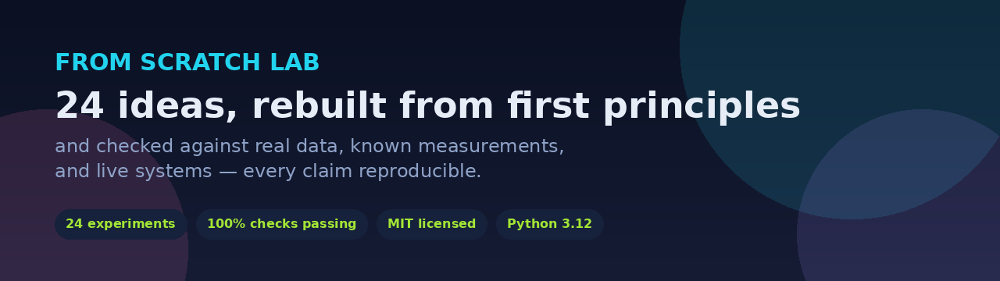
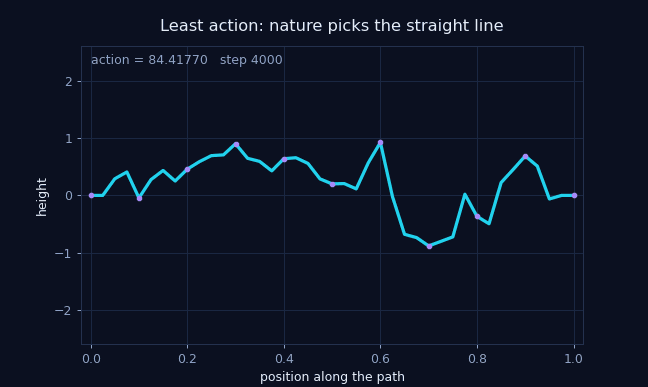
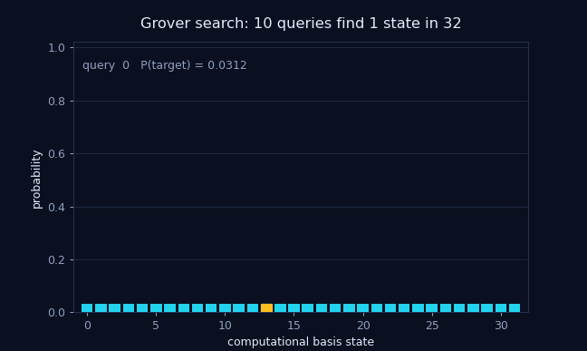
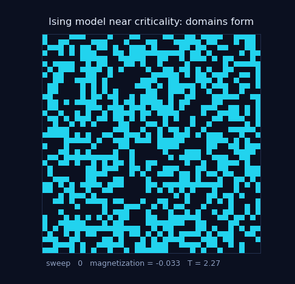
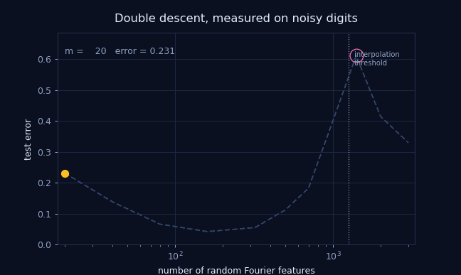
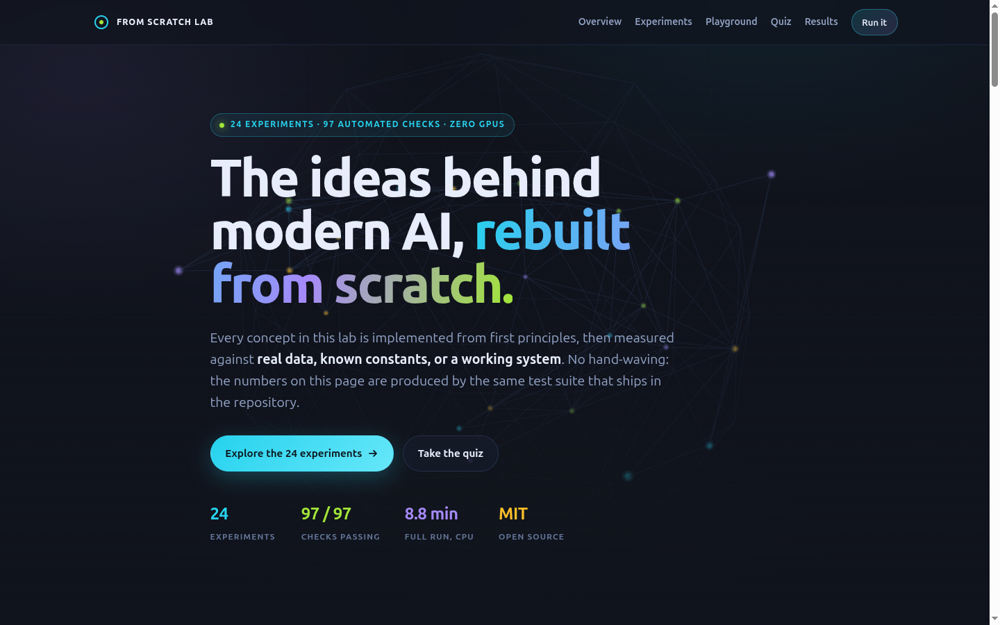
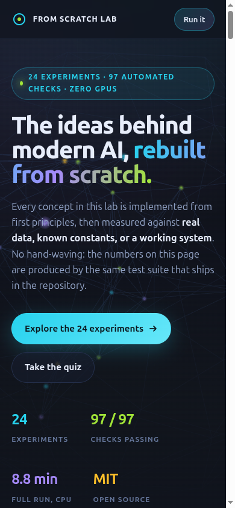
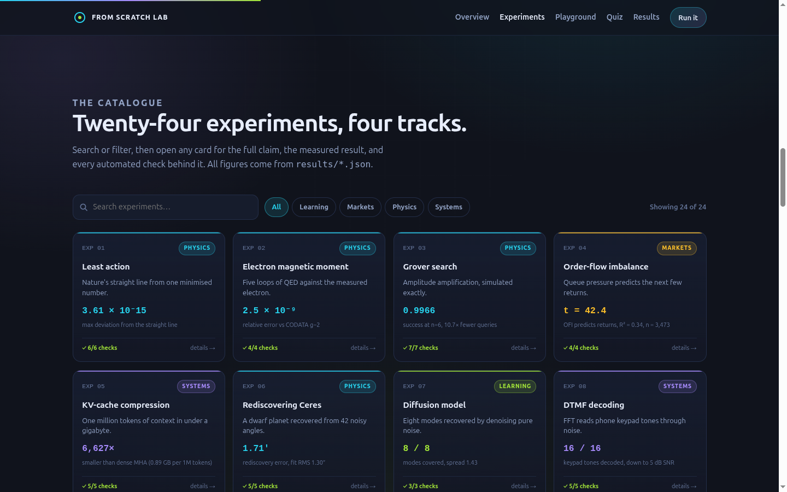
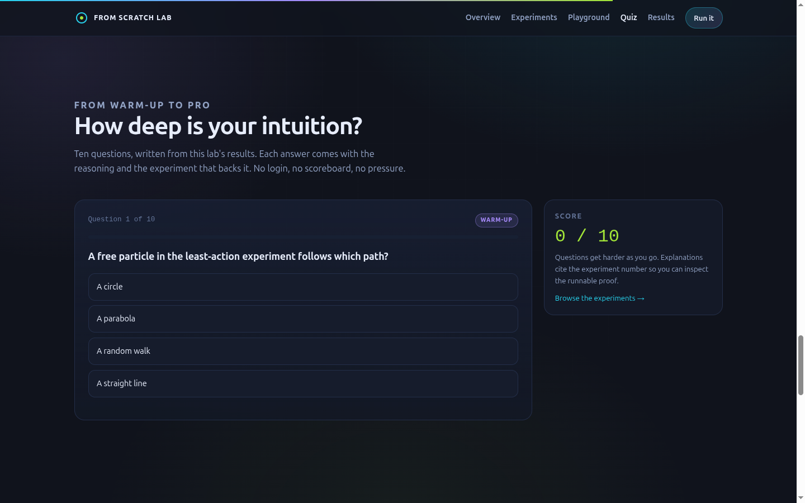
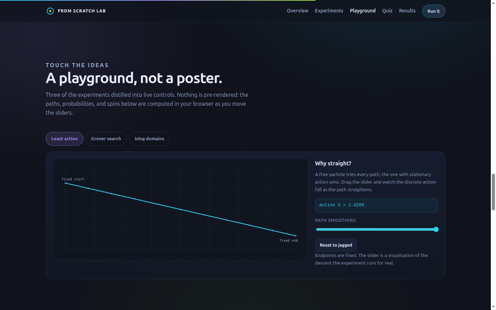

# From Scratch Lab

**Twenty-four big ideas, rebuilt from first principles — and verified against reality.**

<p align="center">
  
</p>

<p align="center">
  
  
  
  
  
  
</p>

## The one-paragraph version

Most technical claims are taken on trust: a model works, a market effect exists, an algorithm is fast, a physical constant is what the textbook says. **From Scratch Lab rebuilds 24 of those claims from nothing but the underlying idea, then tries hard to break each one with independent checks.** Every result is a number in a JSON file, produced by code you can read and rerun — from the path a particle takes to the memory bill of a million-token context, from the statistics of Riemann zeros to the cryptography inside a VPN.

For a business audience, it is a **credibility asset**: a compact, self-contained body of work that demonstrates deep technical judgment, numerical care, and the ability to explain hard ideas to non-specialists. For a learner, it is a **guided ladder** from "I've heard of it" to "I can derive it, code it, and defend the result." For an engineer, it is a **reference implementation** of the mechanisms behind modern AI systems, with the failure cases left visible.

> "What I cannot create, I do not understand." — Richard Feynman

---

## Contents

- [Why this exists](#why-this-exists)
- [What is inside](#what-is-inside)
- [🌱 Beginner guide](#-beginner-guide--read-this-and-you-are-a-professional)
- [See it in action](#see-it-in-action)
- [Quickstart](#quickstart)
- [The 24 experiments](#the-24-experiments)
- [How verification works](#how-verification-works)
- [Three results worth reading](#three-results-worth-reading)
- [Who this is for](#who-this-is-for)
- [Reproducibility and data provenance](#reproducibility-and-data-provenance)
- [The website](#the-website)
- [Limitations: what this is not](#limitations-what-this-is-not)
- [FAQ](#faq)
- [License and acknowledgements](#license-and-acknowledgements)

---

## Why this exists

Reconstruction is the strongest form of understanding, and a reconstruction that cannot be checked is only a story. This repository is a working laboratory, not a tutorial collection. Each experiment:

1. **Implements the mechanism directly** — no solver or library that already knows the answer.
2. **States checks that can fail** — analytic limits, known test vectors, held-out data, published measurements, or live market feeds.
3. **Compares against an external reference** wherever one exists: CODATA, JPL Horizons, RFC 8439, an independent crypto library, live exchange data, published model configs.
4. **Records effect sizes, not just pass/fail** — the JSON keeps the actual errors, t-statistics, perplexities, and distances, so a reader can judge the strength of every claim.
5. **Publishes the failures too** — non-monotonic curves and broken baselines are reported as results, not hidden.

The current run passes **97 of 97 checks across 24 experiments**, in about **9 minutes on a CPU-only machine**.

---

## What is inside

| Area | Experiments | Examples of what gets rebuilt |
|------|-------------|-------------------------------|
| Physics and quantum | E01–E03, E06, E10, E11 | Least action, the electron's magnetic moment, Grover search, Ceres' orbit, Boltzmann entropy, GPS relativity |
| Markets | E04 | Order-flow imbalance and price impact, on historical and live data |
| Systems and models | E05, E09, E13, E15, E18 | KV-cache arithmetic, INT8/INT4 quantization, mixture of experts, retrieval for RAG, paged attention |
| Learning and generation | E07, E12, E16, E17, E19–E22, E24 | Diffusion, Markov entropy, a small GPT, AlphaZero, ResNet, Q-learning, GANs, double descent, self-supervised learning |
| Signals, math, crypto | E08, E14, E23 | DTMF decoding, Riemann zeros vs random-matrix theory, ChaCha20-Poly1305 |

Every experiment ends with PASS/FAIL checks written *before* the result was known, recorded next to the metrics. The aggregate report is `results/summary.json`.

---

## 🌱 Beginner guide — read this and you are a professional

You do not need a PhD to start. You need one hour, Python 3.12, and the willingness to run things and look at what comes back.

**Step 1 — Watch one idea become a picture.** Open `assets/gifs/least_action.gif`. A particle is asked to travel between two points; the code searches over possible paths and the classical straight line emerges because it makes the action *stationary*. That single picture is the core of E01.

**Step 2 — Run the fastest checks.**

```bash
python -m venv .venv
source .venv/bin/activate          # Windows: .venv\Scripts\activate
pip install -e ".[torch]"
make smoke
```

Three experiments run in roughly two seconds. You will see `PASS` lines and a `3/3 experiments passed` summary.

**Step 3 — Run one experiment on its own and read its receipt.**

```bash
python scripts/run_all.py e14_riemann_gue
cat results/e14_riemann_gue.json
```

The JSON tells you exactly which claim was tested, whether it passed, and the measured number. That is the habit this lab teaches: **never accept a result without its receipt.**

**Step 4 — Run everything (about 9 minutes on CPU).**

```bash
make all
make test
```

**Step 5 — Open the interactive website.** In the project folder:

```bash
python -m http.server 8000
```

Then visit `http://localhost:8000/preview.html`. You can search all 24 experiments, move a particle along different paths, run Grover's algorithm step by step, simulate a magnet, and take a ten-question quiz that checks whether you can defend the claims.

**Step 6 — Explain one result to someone else, without notes.** If you can explain why the electron's measured magnetic moment agrees with a five-loop calculation to nine significant figures — and what would make that agreement fail — you own the idea.

That is the whole method: implement it, measure it, compare it, explain it. **You will know more than most interview candidates.** Let's work this out in a step-by-step way to be sure we have the right answer, every time.

### Glossary for the first ten minutes

| Term | Plain meaning |
|------|---------------|
| Action | A number assigned to a path; nature prefers paths where it is stationary |
| Gradient descent | repeatedly nudging parameters downhill to reduce an error |
| QED series | A sum of correction terms in quantum electrodynamics, ordered by powers of the fine-structure constant |
| Amplitude amplification | Grover's trick: rotate probability toward the answer with each query |
| OFI | Order-flow imbalance: signed buying minus selling pressure at the best quotes |
| KV cache | Stored keys and values that let a language model reuse earlier context |
| Quantization | Storing weights in 8 or 4 bits instead of 32 to save memory |
| GUE | Gaussian Unitary Ensemble: the random-matrix statistics that Riemann zeros appear to follow |
| Double descent | Test error rises near the interpolation threshold, then falls again with more capacity |
| AEAD | Authenticated encryption: confidentiality plus a tamper-evident tag |
| TLE | Two-Line Element: the public orbital recipe for a satellite |
| Linear probe | A simple classifier trained on frozen features to test how useful they are |

If a term is still fuzzy, search this page for it, open the matching experiment, and read its checks. The code is deliberately short and the comments explain the physics or math, not the syntax.

---

## See it in action

### Animated results

| | |
|---|---|
| **Least action** — the classical path emerges from a search over paths.<br> | **Grover search** — probability concentrates on the target in about √N steps.<br> |
| **Ising model** — a magnet orders itself as temperature falls.<br> | **Double descent** — test error peaks, then improves past the interpolation threshold.<br> |

A narrated tour of the whole lab is in [`assets/videos/lab-tour.mp4`](assets/videos/lab-tour.mp4) (about 10 seconds, silent loop).

### The interactive showcase

| Desktop | Mobile |
|---------|--------|
|  |  |
|  |  |

<p align="center">
  
</p>

The site includes a 3D hero, a searchable experiment explorer, three live playgrounds, and a quiz. It is a single static page — no build step, no server-side code, no tracking.

---

## Quickstart

Clone the repository and enter the project folder:

```bash
git clone git@github.com:M0-AR/first-principles-science-and-ai.git
cd first-principles-science-and-ai
```

Then create an environment and install:

```bash
python -m venv .venv
source .venv/bin/activate
pip install -e ".[torch]"

make smoke        # E01, E08, E20 — about 2 seconds
make all          # all 24 experiments — about 9 minutes on CPU
make test         # regression tests — 20 passed
```

Useful variants:

```bash
python scripts/run_all.py --list                       # list experiment ids
python scripts/run_all.py e05_kv_cache e14_riemann_gue # run a subset
python scripts/run_all.py --smoke                      # same as make smoke
```

Or run everything in Docker, with no host dependencies:

```bash
docker compose up --build
```

Results land in `results/<experiment>.json`, figures in `results/figures/`, and the aggregate report in `results/summary.json`. The runner exits non-zero if any check fails.

**Requirements:** Python 3.12, NumPy, SciPy, scikit-learn, Matplotlib, pandas, mpmath, requests, cryptography, and PyTorch (CPU is sufficient). No GPU is required.

### KV-cache budget compiler

E05 does the first-principles KV arithmetic. `scripts/kvbudget.py` turns that arithmetic into a deployment planner for 20 public model configs:

```bash
python scripts/kvbudget.py --list-models
python scripts/kvbudget.py --model meta-llama/Llama-3.1-8B-Instruct \
  --gpu-memory-gb 24 --context 32768 --concurrency 1
```

It accounts for GQA/MQA/MLA, hybrid sliding-window layers, paged allocation, tensor-parallel KV replication, FP8/INT8/INT4/INT2, and optional eviction. Every plan reports KV bytes per token, maximum context, concurrency, quality risk, and total GPU memory. The formulas, evidence, and limitations are in [`research/2026-kv-cache-best-practices.md`](research/2026-kv-cache-best-practices.md).

`python scripts/kvbudget_bench.py` validates the formulas against a measured OPT-125m cache, a synthetic GPU allocation, and a quantization retrieval test; results are in `results/kvbudget.json`. The compiler is independent of the 24 experiments and does not change their count.

---

## The 24 experiments

| # | Experiment | Headline verified result |
|---|------------|--------------------------|
| E01 | **Least action** | Discrete free-particle path is a straight line to `max\|Δx\| = 3.6×10⁻¹⁵`; the classical action is stationary to `9.6×10⁻¹⁵` |
| E02 | **Electron g−2** | Five-loop QED gives `a_e = 0.0011596521777`, within **2.45×10⁻⁹** of CODATA 2022 — nine significant figures |
| E03 | **Grover search** | 6 qubits reach success probability **0.9966** in 6 queries instead of 64 — a **10.7×** advantage |
| E04 | **Order-book impact** | OFI slope **34.59 bps**, `t = 42.4`, `R² = 0.341` on 3,473 AAPL hours; live BTC test `t = 6.2` |
| E05 | **KV-cache arithmetic** | **890 bytes/token** from the published config; a 1M-token context costs **0.89 GB** — 6,627× smaller than dense MHA |
| E06 | **Gauss and Ceres** | Fitted orbit rediscovery error **1.71 arcmin** after 11 months; fit RMS **1.30″** at 2″ noise |
| E07 | **Diffusion** | All **8 of 8** mixture modes covered (fractions 0.10–0.14), no mode collapse |
| E08 | **Fourier and DTMF** | **16 of 16** telephone keys decoded at every SNR down to **5 dB** |
| E09 | **Quantization** | INT8 is lossless (**0.9999×** FP32 perplexity); group INT4 is **1.10×**; naive INT4 explodes to **2,863** |
| E10 | **Boltzmann** | Metropolis matches `Ω(E)e^(−E/T)` with TV distance **0.0092**; entropy **3.47 vs 0.69 k_B**; Maxwell–Boltzmann KS `p = 0.958` |
| E11 | **GPS** | Relativistic offset **38.50 μs/day** (textbook 38.5); position recovered to **0.99 m**; constellation radius **26,560 km** |
| E12 | **Markov and entropy** | Best order is 4: **2.408 bits/char** (3.586 → 2.408 → 2.567); more context hurts on a 1.1 MB corpus |
| E13 | **Mixture of experts** | **25%** of expert compute active, **90.9%** accuracy, routing entropy **2.997/3 bits**, no dead experts |
| E14 | **Riemann zeros** | GUE KS distance **0.0241** vs Poisson **0.3039** — random-matrix statistics win by **12.6×** on 20,000 zeros |
| E15 | **Retrieval for RAG** | BM25 puts a same-category document in the top 5 **37.5%** of the time (chance 25%); TF-IDF reaches **43.9%** |
| E16 | **GPT** | A 440,699-parameter character Transformer reaches **2.291 bits/char**, beating the best Markov chain (2.408) |
| E17 | **AlphaZero** | **0.890** score against random play (84 wins, 10 draws, 6 losses) from **9,944** self-play positions only |
| E18 | **PagedAttention** | Bit-exact vs dense attention (`max\|diff\| = 0.0`); **1.8%** slot waste vs **79.5%** naive — **4.8×** saving |
| E19 | **ResNet** | Gradient at layer 1: **1.8×10⁻⁹** plain vs **10.1** residual (**5.6×10⁹×**); accuracy **95.6% vs 92.0%** |
| E20 | **Q-learning vs SARSA** | Q-learning finds the **13-step** optimal path; SARSA takes 19 but earns **−22.2 vs −68.7** online return |
| E21 | **GAN** | All ten digit classes covered; diversity **84%** of real data; discriminator **D(real)=0.753, D(fake)=0.332** |
| E22 | **Double descent** | Test error peaks at **0.611** at 1,400 features, then falls to **0.372** past the threshold (**0.330** at the widest point) |
| E23 | **VPN cryptography** | ChaCha20 keystream matches RFC 8439 exactly; AEAD matches an independent library on **20/20** cases; a flipped bit is rejected |
| E24 | **Self-supervised learning** | A linear probe on unlabeled contrastive features reaches **97.6%** vs **96.1%** for raw pixels; no representation collapse |

Full per-check detail, including the checks that failed during development, is in `results/`.

---

## How verification works

Each experiment follows the same contract:

1. **Implement the mechanism directly.** When the honest implementation is impossible with available data, the substitute is stated explicitly and the approximation is documented — never silently patched.
2. **State checks that can fail.** "Gradient is preserved", "perplexity within 5%", "recovered position < 5 m", "entropy within 1.5–2.4 bits/char". A check that cannot fail is not a check.
3. **Compare against an external reference:** CODATA, JPL Horizons, RFC test vectors, an independent crypto library, live exchange data, published model configs.
4. **Record effect sizes.** The JSON keeps the observed numbers so a reader can judge the strength of each claim.
5. **Publish the negative results.** E12's non-monotonic Markov curve and E09's naive-INT4 degradation are results, not embarrassments.

A check record looks like this:

```json
{
  "label": "KS distance to GUE is below 0.03",
  "passed": true,
  "detail": "D=0.0241"
}
```

The aggregate `results/summary.json` records status, runtime, checks, and metrics for all 24 experiments. The runner exits non-zero if any check fails, so the repository's claims are only as strong as its weakest declared test.

---

## Three results worth reading

### The zeros of the Riemann zeta function look like random matrices

Using the first 20,000 zeros from Odlyzko's table, with no number-theoretic assumptions beyond the zeros themselves:

| Statistic | Value | Interpretation |
|-----------|-------|----------------|
| Mean normalized spacing | 1.0000 | unfolded spectrum |
| KS distance to Poisson | **0.3039** | independent random levels: rejected |
| KS distance to GUE | **0.0241** | random-matrix statistics: consistent |
| Ratio | **12.6×** | GUE wins by an order of magnitude |
| Pair-correlation error vs GUE | 0.0358 | two-point function matches |

The zeros repel each other exactly as eigenvalues of a random Hermitian matrix do — the strongest numerical hint behind the Hilbert–Pólya conjecture. This is statistical evidence, not a proof, and the Wigner surmise is an approximation; the tolerance is set accordingly.

### Price impact is linear at hourly granularity — and the famous square-root law is untestable here

The Cont–Kukanov–Stoikov order-flow-imbalance regression is fitted to 3,473 hourly snapshots of a 10-level AAPL book: slope **34.59 bps** per unit OFI, `t = 42.4`, `R² = 0.341`, mean spread 0.85 bps. The same estimator runs against the live Coinbase BTC-USD book, sampled every two seconds for about two minutes; the live slope stays positive with a t-statistic around **6** on that run.

The honest note matters: the celebrated square-root impact law is a metaorder statement and cannot be tested on hourly snapshots, which contain no parent-order decomposition. What *is* testable at this granularity is a tight linear relation between order-flow imbalance and contemporaneous returns. A result must say what the data can and cannot support.

### A million-token context for under a gigabyte

From the published DeepSeek-V4.1-Flash configuration: 2.5 KV entries per token (four source layers with compression ratios 2, 2, 2, 1), 356 bytes per entry (288 bytes of 512-dim latent plus 64-dim RoPE at FP4, plus a 68-byte index), giving **890 bytes/token**. A 1M-token context therefore costs **0.89 GB** — 6,627× smaller than dense multi-head attention and 104× smaller than GQA-1. This is a derivation from a real config, not a back-of-envelope estimate.

---

## Who this is for

| Audience | What you get |
|----------|--------------|
| **Business and product leaders** | A concrete, low-risk way to evaluate technical depth before a hire, partnership, or investment conversation. The claims are reproducible, the failure modes are documented, and the writing is plain. |
| **Students and career switchers** | A guided path from intuition to implementation. Start with the animations, run the smoke tests, then pick one experiment and read its receipt. |
| **Practicing engineers** | Compact reference implementations of order-flow regression, KV-cache accounting, quantization, paged attention, MoE routing, diffusion, AlphaZero, and more. |
| **Educators** | Ready-made demonstrations with honest error bars, suitable for a seminar, a lab session, or a guided reading course. |
| **Researchers and reviewers** | A reproducibility-first artifact: fixed seeds, explicit substitutes, external references, and negative results left in place. |
| **Interviewers and candidates** | A shared object to discuss: not "have you heard of X?" but "here is X, here is the check, here is where it breaks — explain it." |

The lab is deliberately small-scale. The point is mechanism and evidence, not state-of-the-art benchmark scores.

---

## Reproducibility and data provenance

### Data and references

| Data / reference | Source | Notes |
|------------------|--------|-------|
| Tiny Shakespeare (1.1 MB) | `karpathy/char-rnn` | public-domain text |
| Odlyzko zeros | Odlyzko's published table of the first 100,000 nontrivial zeros | 1.7 MB; E14 analyses the first 20,000 |
| Ceres states | JPL Horizons API | 42 nightly geometric vectors, 1801 |
| AAPL limit-order book | LOBSTER academic sample file, `lobster_aapl_10_level.csv` | 3,474 hourly top-10 snapshots, 2024-06-06 → 2026-06-05; bundled with LOBSTER's sample documentation |
| BTC-USD | Coinbase Exchange public API | live, sampled at run time |
| DeepSeek config | `deepseek-ai/DeepSeek-V4.1-Flash` `config.json` | used for the 890 B/token derivation |
| distilgpt2 (82M) | Hugging Face | cached under `data/hf` |
| MNIST | torchvision | auto-downloaded |
| 20 Newsgroups | scikit-learn / figshare archive | bundled cache in `data/sklearn/`; the figshare host can return 403 to fresh downloads |
| GPS TLEs | CelesTrak `gps-ops` | live, cached after first fetch |
| RFC 8439 vectors | IETF | hard-coded test vectors |

The LOBSTER file is an academic sample distributed for research and teaching. It is not a claim about any vendor's live feed. The live Coinbase numbers move between runs; every other experiment is seeded.

### Environment

Python 3.12, NumPy, SciPy, scikit-learn, Matplotlib, pandas, mpmath, requests, cryptography, PyTorch 2.x (CPU sufficient), and transformers. The container image is `python:3.12-slim`; `docker compose up --build` reproduces every experiment without host dependencies. A full `--all` run takes roughly 9 minutes on a CPU-only machine, dominated by E19 (MNIST training), E04 (live sampling), and E16 (Transformer training).

### Layout

```
src/fsl/common.py          result schema, check helper, paths
src/fsl/registry.py        the 24 experiments
src/fsl/experiments/       one file per idea
src/kvbudget/              KV budget compiler (capacity + quality + Pareto)
data/model_zoo.json        20 public model configs and exact weight sizes
scripts/run_all.py         runner (--all / --smoke / --list)
scripts/kvbudget.py        CLI for the KV budget compiler
scripts/build_site_data.py generates assets/site-data.js from results
scripts/make_media.py      regenerates the banner, GIFs, and tour video
research/                  evidence notes behind the compiler
tests/test_lab.py          registry + import + end-to-end smoke tests
tests/test_kvbudget.py     deterministic compiler tests
results/                   metrics JSON + figures, generated
preview.html               the interactive showcase (single file)
assets/                    banner, social preview, GIFs, screenshots, video
```

---

## The website

`preview.html` is a self-contained showcase: no build step, no framework, no analytics. It reads `assets/site-data.js`, a generated snapshot of the 24 results, so the site and the JSON can never disagree.

### Live links

| Entry point | Link | What happens |
|-------------|------|--------------|
| `/` | <https://m0-ar.github.io/first-principles-science-and-ai/> | redirects to `preview.html` |
| `/preview.html` | <https://m0-ar.github.io/first-principles-science-and-ai/preview.html> | canonical showcase |
| `/docs/preview.html` | <https://m0-ar.github.io/first-principles-science-and-ai/docs/preview.html> | mirror of the showcase, for the `/docs` publishing path |

GitHub Pages is configured to deploy from **`main` / `/ (root)`**. The root `index.html`, root `preview.html`, and `docs/preview.html` mirror are all present, so each of the three links above resolves in a browser with HTTP 200. Asset paths are relative (`assets/…` at the root, `../assets/…` in the mirror), which keeps project Pages URLs under the repository path working.

Open it through a local server so the 3D hero can load its module:

```bash
python -m http.server 8000
# then open http://localhost:8000/preview.html
```

The page ships with a 2D canvas fallback if the 3D module cannot load, respects reduced-motion preferences, and is keyboard-accessible.

### Publish it with GitHub Pages

1. Push the repository to GitHub with `index.html` at the root of the `main` branch.
2. Open **Settings → Pages**.
3. Under **Build and deployment**, choose **Deploy from a branch**.
4. Select branch **`main`** and folder **`/ (root)`**, then save.
5. GitHub serves the site at <https://m0-ar.github.io/first-principles-science-and-ai/>. `index.html` redirects to `preview.html`; `.nojekyll` is included so static assets are served as-is, and `docs/preview.html` is a ready mirror for the `/docs` publishing path.

After a deployment, confirm all three entry points return HTTP 200:

```bash
BASE="https://m0-ar.github.io/first-principles-science-and-ai"
for p in "" "preview.html" "docs/preview.html"; do
  printf "%s -> " "/$p"
  curl -s -o /dev/null -w "%{http_code}\n" "$BASE/$p"
done
```

No secrets, environment variables, or server runtime are required.

---

## Limitations: what this is not

- **Not a claim of new theorems.** The physics results reproduce known theory and known measurements; the value is in independent reconstruction and explicit error bars.
- **Not all experiments use original raw data.** E06 uses Horizons states plus Piazzi-level noise instead of the 1801 manuscript; E02 evaluates the published five-loop series rather than deriving the five-loop integrand. These substitutions are stated in the code and here.
- **Not a benchmark leaderboard.** Models are deliberately small: the point is mechanism, not state of the art.
- **Not deterministic where the world isn't.** E04 runs against a live exchange; reruns will move the BTC numbers. Seeds pin everything else.
- **Not financial, medical, or legal advice.** The market experiment is a measurement exercise, not a trading strategy.

---

## FAQ

**Do I need a GPU?**
No. Every experiment runs on CPU; the full suite takes about 9 minutes on a modern laptop.

**How long does a single experiment take?**
Most finish in under 10 seconds. E16, E17, E19, and E22 are the slower ones. `make smoke` finishes in about 2 seconds.

**Can I run just one idea?**
Yes: `python scripts/run_all.py e14_riemann_gue`. The id list is `python scripts/run_all.py --list`.

**Why do the live numbers differ between runs?**
E04 samples the real Coinbase BTC-USD book. The historical AAPL result is fixed; the live slope and t-statistic move with the tape.

**What if a dataset download is blocked?**
The 20 Newsgroups cache is bundled in `data/sklearn/`, and the other inputs are cached after first use. The live BTC portion fails honestly with a recorded error rather than silently skipping.

**Is the website part of the automated checks?**
The Python experiments and their checks are automated. The site is verified manually across desktop and mobile widths, including the quiz, playgrounds, and copy-to-clipboard feedback.

**Can I reuse this?**
Yes, under the MIT license. Attribution is appreciated; see below.

---

## License and acknowledgements

Released under the **MIT License** — see [`LICENSE`](LICENSE). You may use, modify, and distribute the code with attribution.

This lab stands on decades of public work: Feynman's *Lectures* on least action; Gauss' 1801 recovery of Ceres; Cont, Kukanov, and Stoikov on order-flow imbalance; Ho, Jain, and Abbeel on paged attention; Ho et al. on DDPM; He et al. on residual learning; Shazeer et al. on sparsely-gated mixtures of experts; Silver et al. on AlphaZero; Odlyzko's zeta-zero tables; the DeepSeek-V4 technical report for the KV-cache configuration; RFC 8439 for ChaCha20-Poly1305; Belkin et al. and Nakkiran et al. on double descent; and Chen et al. on contrastive self-supervision. Dataset and service credits are listed under [data provenance](#reproducibility-and-data-provenance).

The three.js runtime vendored under `assets/vendor/` is distributed under its own MIT license; see `assets/vendor/THREE-LICENSE.txt`.

---

*Implement it. Measure it. Compare it. Write down what the measurement refused to support.*
